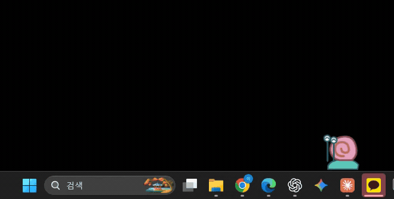
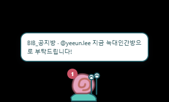
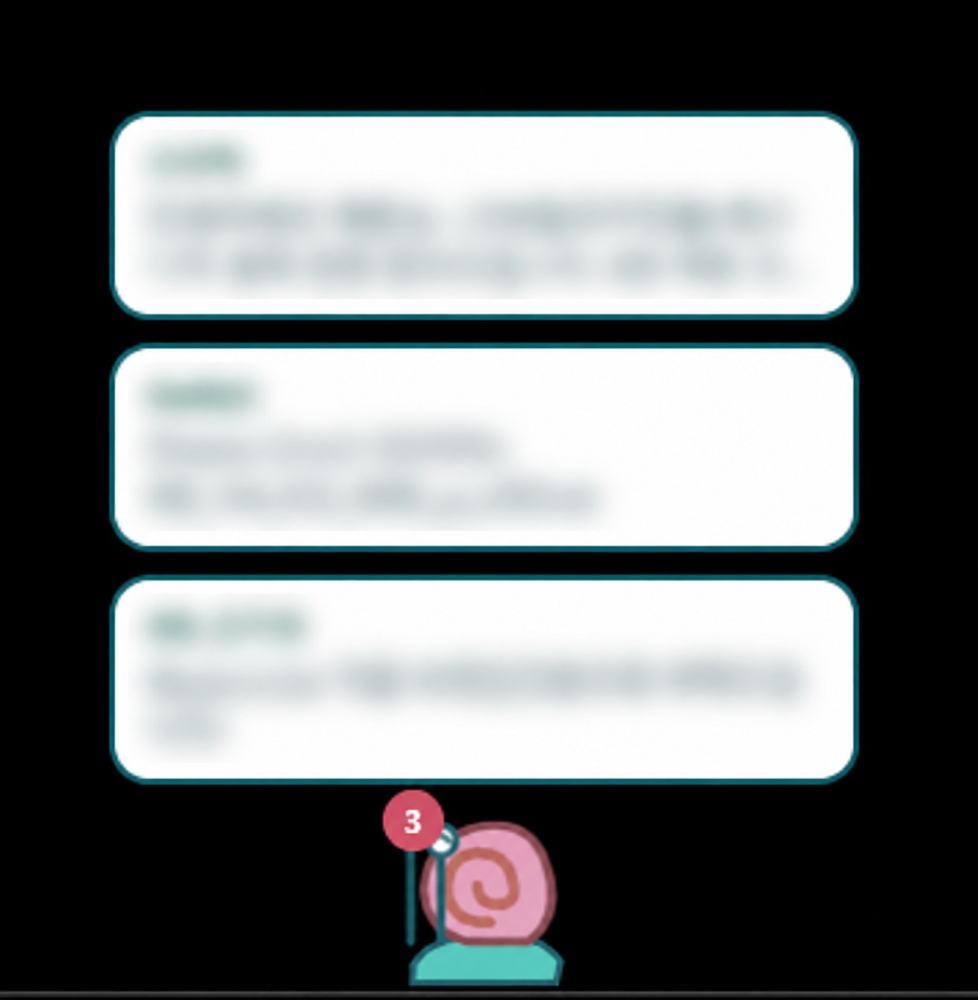

# Rocket Snail 🐌

**확인해야 할 Rocket.Chat 메시지를 바탕화면의 달팽이가 말풍선으로 알려 줍니다.**

## 주요 기능

- **메시지 선택:** 방별 모든 메시지·멘션만·무시, DM 별도 설정, 키워드 알림
- **말풍선 알림:** 여러 메시지가 위로 쌓이고, 누르면 설치된 Rocket.Chat 앱에서 원본 열기
- **확인 후 정리:** 서버의 읽음 정보에 따라 자동 정리, 스레드 답글 직접 확인 완료, 정리 내역 복구
- **달팽이 꾸미기:** 껍데기 무늬·색, 몸통 색, 눈 모양, 크기 변경
- **위치와 움직임:** 모니터 선택, 드래그 이동, 상하좌우 가장자리 이동, 움직임 끄기
- **편의 설정:** 마우스를 올리거나 설정 창을 열면 정지, Windows 시작 시 실행

## 사용 모습

### 평상시

[영상 보기](docs/media/snail-walking.mp4)

### 알림 한 개

### 알림 여러 개

화면의 방 이름·사용자 이름·메시지는 블러 처리했습니다.

## 설치하기

1. **Windows x64 PC**에 Rocket.Chat 데스크톱 앱을 설치합니다.
2. [다운로드](https://github.com/itsyennie/rocket-snail/releases)에서 Windows ZIP을 받습니다.
3. **전체 압축을 해제한 뒤 `RocketPet.exe`를 실행**합니다. EXE 하나만 옮기지 마세요.

별도 설치 과정이나 관리자 권한은 필요하지 않습니다. 현재는 코드 서명 없는 테스트 버전입니다.

## 사용하기

1. **연결·캐릭터**에서 Rocket.Chat 서버 주소, 본인의 사용자 ID와 개인 접근 토큰을 입력하고 **저장하고 연결**을 누릅니다. 조직에서 허용한 계정과 토큰을 사용하세요.
2. **방과 키워드**에서 챙길 메시지를 정합니다. 공지방은 모든 메시지, 다른 방은 내 멘션만 받도록 설정할 수 있습니다.
3. 말풍선을 누르면 Rocket.Chat 데스크톱 앱에서 해당 메시지가 열립니다. 여러 알림은 최대 5장 높이로 표시하며 더 많으면 스크롤합니다.
4. 읽음 정보가 확인되면 자동 정리합니다. 이미 읽은 스레드가 남아 있다면 **확인 대기 → 직접 확인 완료**를 누르세요. **최근 정리**에서 복구할 수 있습니다.

달팽이를 클릭하면 설정이 열리고, 드래그하면 위치를 옮길 수 있습니다. 외형은 **달팽이 꾸미기**, 모니터·위치·움직임은 **연결·캐릭터**에서 바꿉니다. 종료는 설정 창이나 시스템 트레이의 **종료**를 누르세요.

업데이트할 때는 앱을 종료한 뒤 새 ZIP을 다른 폴더에 풀어 실행합니다. 저장된 계정·규칙·외형은 유지됩니다.

메시지를 열기만 해서는 목록에서 사라지지 않습니다. 이 앱은 Rocket.Chat 읽음 상태를 바꾸거나 메시지를 보내지 않습니다. 토큰은 Windows에서 암호화해 저장하며 메시지 일부와 설정은 PC에 저장합니다.

## 제작자와 이용 조건

기획·제작: **[itsyennie](https://github.com/itsyennie)**. AI 개발 도구를 활용해 제작했습니다.

- 개인용·업무용으로 무료로 설치하고 사용할 수 있습니다. 본인 사용을 위한 소스 수정과 빌드도 허용합니다.
- 다른 사람에게 소개할 때는 [공식 다운로드 페이지](https://github.com/itsyennie/rocket-snail/releases)를 공유해 주세요.
- 수정본 재배포, 앱 판매, 다른 제품에 포함해 배포하려는 경우 제작자에게 먼저 문의해 주세요. 제작자가 권리를 가진 부분의 해당 이용에는 사전 허락이 필요합니다.
- 제작자 표기와 이용 조건을 유지하고, 수정본을 제작자의 공식 버전으로 표시하지 마세요.
- 외부 라이브러리·캐릭터·상표에는 각 권리자의 조건이 적용됩니다. AI 생성 부분 전체에 독점적 저작권이 있다고 주장하지 않습니다.

자세한 범위와 예외는 [이용 조건](LICENSE.md) 및 [제3자 고지](THIRD_PARTY_NOTICES.md)를 확인하세요. 이용 허락 문의는 [GitHub 이슈](https://github.com/itsyennie/rocket-snail/issues/new)로 남길 수 있습니다.
